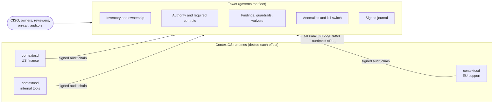

# 1. Concepts and principles

## The problem

An organisation that deploys AI agents at scale ends up with many of them: built by
different teams, on different frameworks and models, in different business units and
regions. Each ContextOS runtime governs the agents that pass through it, one effect at a
time: it binds every tool call to an exact digest, checks authority, policy, approvals
and data flow, and signs the result into an audit chain.

That answers "was *this* action allowed?". It does not answer the questions an
organisation is accountable for:

- What agents exist, who owns them, and what can each do?
- Do the controls each agent needs exist where it runs?
- What changed, who approved it, and is anything going wrong?
- Can we prove all of this to an auditor or a regulator?

Those are questions about the **fleet**, asked by people who are not runtime engineers.
Tower answers them.

## Principles

These twelve principles decide every design choice in Tower. Where the ContextOS spec
already states one, Tower implements the spec's version.

1. **Govern at chokepoints, and measure coverage.** Governance is only real where effects
   pass a control point. An agent whose actions bypass a runtime is ungoverned, not
   compliant; a production agent with no governed runs is a finding.
2. **Every agent has an accountable owner.** No owner, no production.
3. **Risk is multi-dimensional; never collapse it into a score.** The spec's ActionRisk
   has five independent dimensions (effect, authority, reversibility, interaction, data
   scope). Tower reports each one and derives requirements from them, never a single
   number or tier.
4. **Requirements come from what an agent can do, not what its owner declares.**
   Declarations inform review; they are never evidence.
5. **Effective authority is a graph, and growth is drift.** A capability added after a
   review needs a new review.
6. **Enforcement is deterministic; intelligence is advisory.** Claude never sits in an
   enforcement path. It drafts and explains; deterministic checks and a person decide.
7. **The governance AI is itself governed.** Read-only tools, scoped to the asker, agent
   data treated as untrusted, every citation checked, every use journalled.
8. **Evidence over assertion.** Every runtime entry is verified before use; every Tower
   decision is signed.
9. **Exceptions are first-class.** Waivers are scoped to one finding and one agent,
   justified, decided by someone else, and expire on their own.
10. **Separation of duties.** Owners do not review their own agents; authors do not
    activate their own guardrails; requesters do not decide their own waivers; the AI
    approves nothing.
11. **Federated by default.** Runtimes keep content in their region; Tower ingests
    identifiers, references, outcomes and counts. Evidence is fetched from the runtime on
    request, and each request is journalled.
12. **Change is checked before it lands.** A drafted guardrail is evaluated against every
    current agent before anyone can save it.

## Glossary

| Term | Meaning | Where in code |
|---|---|---|
| **Runtime** | A `contextosd` deployment. Decides effects; signs an audit chain per tenant. | `crates/contextosd` |
| **Source** | One runtime tenant Tower reads: URL, a read-only `audit:read` key, optionally a `control` key. | `towerd::source` |
| **Audit chain** | A tenant's append-only, Ed25519-signed, hash-linked log of governed events. | `contextos-audit` |
| **`run_admitted`** | The audit entry that attributes a run to its agent, pack, contract, controls, surfaced capabilities and release references. Signed before the run starts. | `contextosd::app::admit` |
| **Collector** | Tails each source's chain from a verified anchor, verifies every page, folds it into the fleet model. | `towerd::collector` |
| **Fleet model** | Per-agent activity counters and hourly buckets, a bounded window of recent run summaries, per-source state and a change feed. | `towerd::fleet` |
| **Agent** | Identified by `agent_urn` when a run names one, otherwise `tenant/agent_id`. | `fleet::agent_key` |
| **Declaration** | What an owner states: owner, team, business unit, purpose, users served, lifecycle, data categories, regulatory contexts. | `towerd::records::Declaration` |
| **Authority graph** | Every capability of every pack an agent runs under, with ActionRisk, marked *offered* (surfaced at admission) or *used* (claimed). | `towerd::authority::graph` |
| **Required profile** | The control profile(s) the authority graph needs, from the standard registry: `core`, `enterprise`, `durable-delegated`, `high-assurance`. An agent can need several. | `authority::requirement` |
| **Required controls** | The mandatory controls of the required profiles plus feature-conditional controls. | `authority::requirement` |
| **Missing controls** | Required controls a runtime where the agent runs does not declare. | `governance::view` |
| **Facts** | The JSON document describing one agent, which guardrails and the AI read. | `governance::facts` |
| **Finding** | Something wrong, for one agent or source, with severity, detail, evidence and a fix. | `governance::Finding` |
| **Guardrail** | An organisation rule: JsonLogic over agent facts, true when an agent violates it. Draft, then active (activated by someone else), then retired. | `api::create_guardrail` |
| **Waiver** | A time-boxed exception: one rule, one agent, a reason, decided by a risk reviewer who did not request it. | `api::request_waiver` |
| **Review** | A risk reviewer's decision on an agent's *current* authority, with the capability list it approved. | `api::review` |
| **Drift** | Capabilities in the graph that the last approved review did not include. | `governance::view` |
| **Anomaly** | An agent's latest hour against its own previous week. | `governance::anomalies` |
| **Journal** | Tower's own signed chain of governance decisions and AI use. | `towerd::records` |
| **Roles** | `viewer`, `owner` (of teams), `risk`, `operator`, `admin`. | `towerd::api::Caller` |

## What Tower is not

- **Not an enforcement point.** Runtimes decide effects; Tower never sits in that path,
  and a Tower outage never stops an agent.
- **Not a second source of truth.** The runtime chains are the record; Tower derives
  views from them and can rebuild from them.
- **Not a content store.** Prompts, tool arguments and personal data stay in the
  runtime.
- **Not a certification.** Regulatory mappings organise evidence; they do not establish
  legal compliance.
