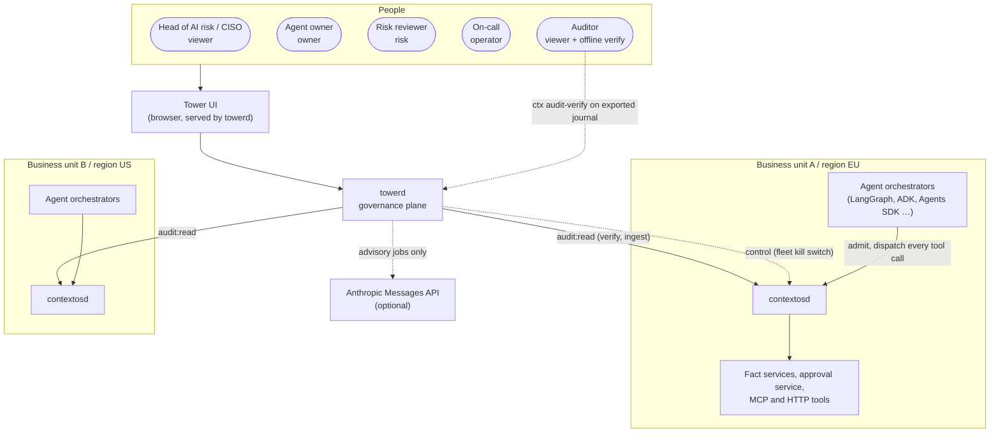
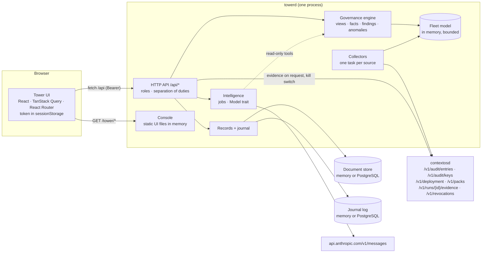
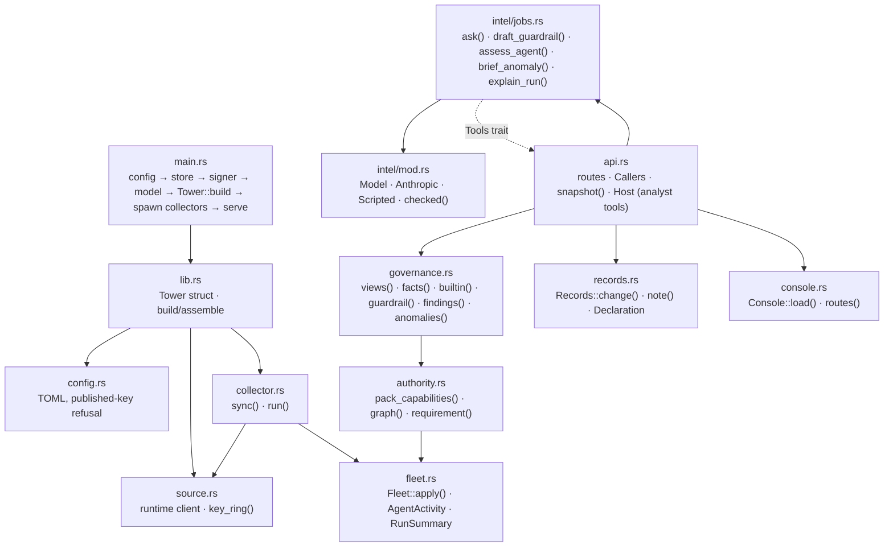
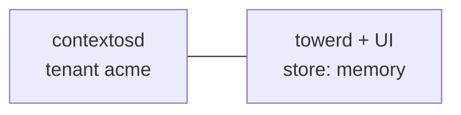
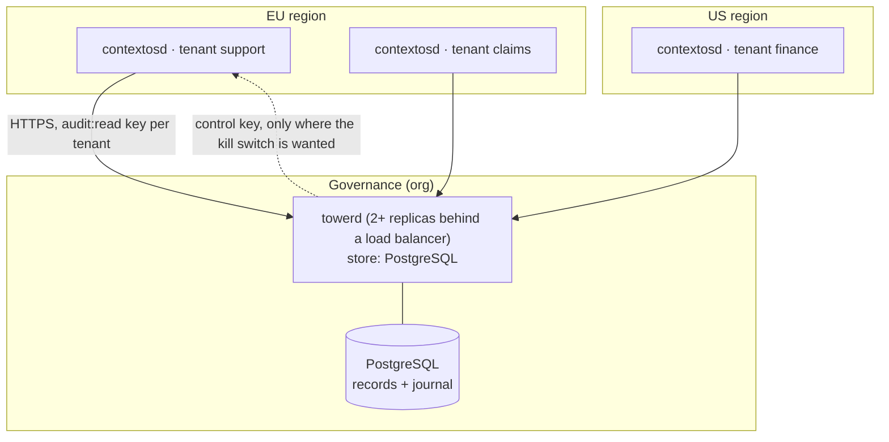
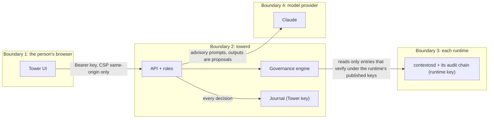

# 2. Architecture

## 2.1 System context



Agents never talk to Tower. They talk to their runtime, as they do without Tower. Tower
reads what runtimes sign, and acts on them only through the runtime's own scoped API.

## 2.2 Containers



| Container | Responsibility | State |
|---|---|---|
| Tower UI | Presents posture, agents, findings, activity, guardrails, waivers, Ask Tower, runtimes, journal. Holds no data. | The signed-in person's key, in the tab only |
| `towerd` API | Authenticates people, enforces roles and separation of duties, computes views on request | None of its own |
| Collectors | Read and verify each source's chain, refresh its deployment and packs every 60 s | Per source: key ring, last verified entry (anchor) |
| Fleet model | Per-agent counters and hourly buckets, recent run summaries, per-source state, change feed | Memory, bounded (see [Operations](09-operations.md#sizing)) |
| Governance engine | Pure functions: authority graph, required controls, facts, findings, anomalies | None |
| Intelligence | Advisory jobs against a `Model` (Anthropic or scripted) | None |
| Records + journal | Declarations, reviews, guardrails, waivers (compare-and-swap); the signed journal | Document store and append-only log (PostgreSQL in production) |

## 2.3 Inside `towerd`



Every box below `api.rs` is a plain module with unit tests; only `collector.rs`,
`source.rs` and `api.rs` do I/O. `governance.rs` and `authority.rs` are pure functions of
the fleet model and the records, which is what makes findings reproducible and easy to
test.

### Kernel reuse

Tower adds no second implementation of anything the runtime already decides:

| Tower needs | It uses |
|---|---|
| Verify an audit page | `contextos_audit::verify_chain` (same as `ctx audit-verify`) |
| Sign its journal | `contextos_audit::AuditWriter` with Tower's own key |
| Control profiles and conditional controls | `contextos_kernel::STANDARD_PROFILE_REGISTRY` |
| Evaluate guardrails | `contextos_policy::jsonlogic::apply` (bounded, `json-logic-js` parity, errors fail visibly) |
| Persist records | `contextos_store::DocumentStore` (memory or PostgreSQL, compare-and-swap) |
| Canonical digests | `contextos_contract::canonical` (RFC 8785) |

## 2.4 What the runtime provides

Tower needed four additions to `contextosd`, all read-only or audit-only:

| Addition | Why Tower needs it |
|---|---|
| `run_admitted` audit entry | Without it nothing in the chain says which agent ran under which pack, contract and controls, so runs could not be attributed to agents |
| `GET /v1/deployment` | The deployment's mode, support declaration (the controls it declares), guards, providers and adapters, by name only; plus the caller's identity |
| `GET /v1/packs` | The tenant's Context Packs, so Tower can build each agent's authority graph from capability risks and approval gates |
| `head` on `GET /v1/audit/entries` | Lets a reader learn the chain length without verifying all of it |

A real `run_admitted` payload (from `examples/tower`):

```json
{
  "run_id": "run_agent_1792599799213",
  "trace_id": "4bf92f3577b34da6a3ce929d0e0e4736",
  "contract_id": "contract_run_agent_1792599799213",
  "agent_id": "agt_support", "agent_urn": null, "agent_role": "support_ops",
  "workload_identity": "spiffe://contextos/agents/support",
  "intent": "support.refund",
  "pack_ref": "ctxpack.support@5.2.0", "requested_pack_ref": "ctxpack.support@5.2.0",
  "profiles": ["contextos.core"],
  "required_controls": [{"control_id": "approval.bound", "control_version": "1"}, "…"],
  "release_refs": [{"artifact_type": "release", "artifact_id": "contextosd", "version": "0.1.0", "sha256": "sha256:…"}],
  "surfaced_capabilities": ["adp_orders.lookup", "adp_payments.issue_refund", "adp_policy.eval"],
  "parent_run_id": null,
  "admitted_by": "svc_quickstart",
  "compiled_context_hash": "sha256:68305e1d…"
}
```

It carries identifiers and references only: no user identity, no prompt, no arguments.

## 2.5 Deployment topologies

### Pilot: one runtime, one Tower



Good for evaluation (`examples/tower`). Records are lost on restart.

### Production: federated business units



- Each **source** is one runtime tenant with its own read-only key. A business unit that
  does not want Tower able to act gives no `control` key; its runtime stays read-only to
  Tower.
- Runtimes stay in their regions. Tower receives metadata; run evidence is fetched on
  request and journalled.
- Several `towerd` replicas can share PostgreSQL for records and the journal. Each
  replica runs its own collectors and builds its own fleet model from the verified
  chains (see [Operations](09-operations.md#scaling)).

### Image

The container image ships both binaries and the UI:

```sh
docker run … image                                   # contextosd (default entrypoint)
docker run --entrypoint /usr/local/bin/towerd … image --config /etc/contextos/towerd.toml
# UI at /usr/share/contextos/tower → [tower] dir = "/usr/share/contextos/tower"
```

## 2.6 Trust boundaries



| Boundary | What crosses it | What protects it |
|---|---|---|
| Browser → `towerd` | The person's key, requests | Roles checked server-side; CSP; key in tab session storage only |
| `towerd` → runtime | Read requests, kill-switch requests | Tenant-scoped keys; runtime scopes and audit; Tower cannot forge runtime history (it lacks the runtime key) |
| Runtime → `towerd` | Audit entries, deployment, packs | Every entry verified against the runtime's published keys before use; a broken chain stops the source |
| `towerd` → model | Facts, findings, run evidence (explain only) | Advisory use only; outputs never change state without a person; every call journalled |

The full threat model is in [Security](07-security.md).

## 2.7 What data lives where

| Data | Runtime | Tower |
|---|---|---|
| Prompts, compiled context, tool arguments, personal data | Yes | No (evidence fetched on request, journalled, not stored) |
| Audit chain (signed) | Yes, the record | Verified, folded into counters; not stored |
| Run summaries (ids, status, capabilities, refusal reasons) | Derivable | Recent window, memory |
| Per-agent counters and hourly buckets | No | Memory |
| Declarations, reviews, guardrails, waivers | No | Store (PostgreSQL in production) |
| Governance journal | No | Append-only log, signed with Tower's key |
