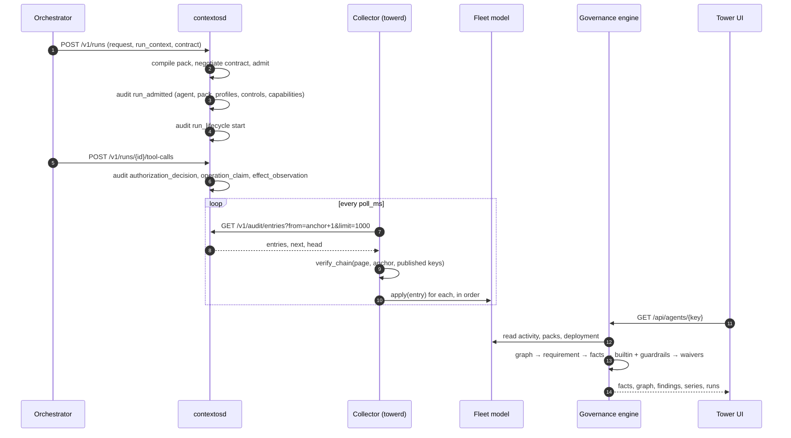
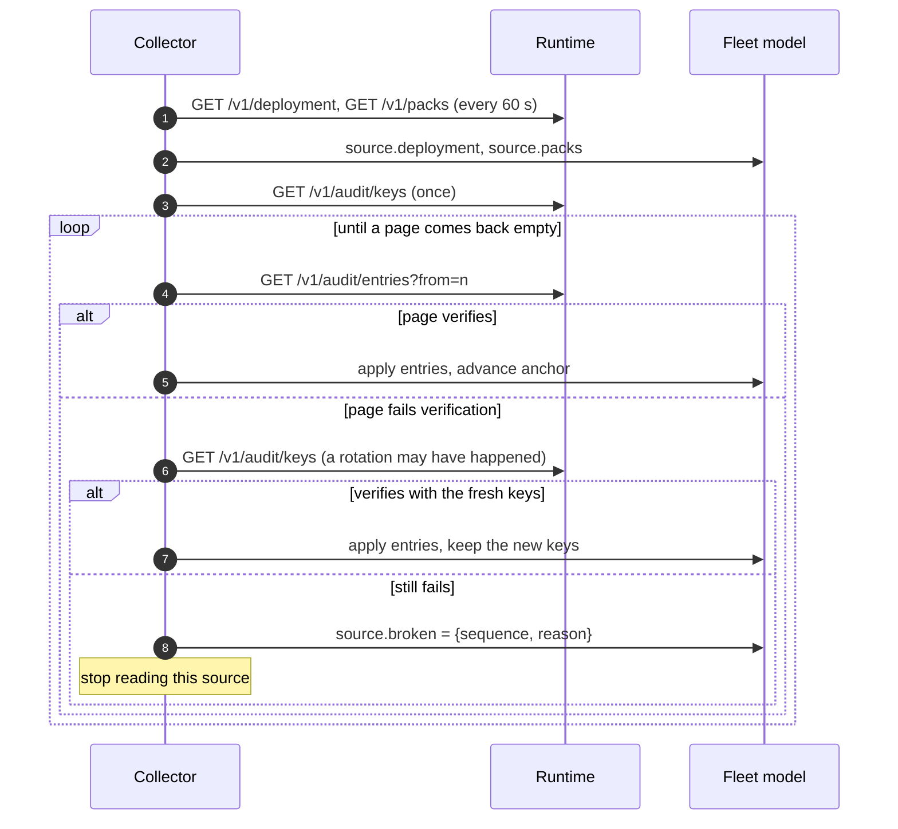
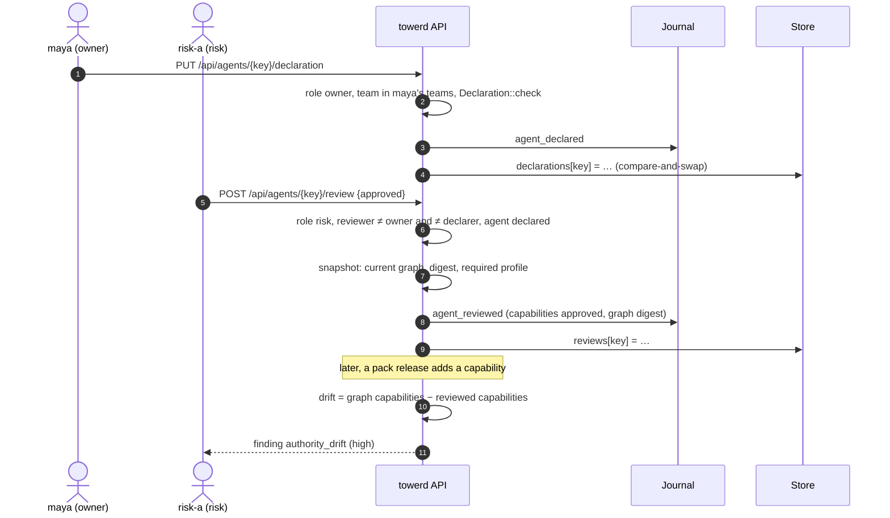
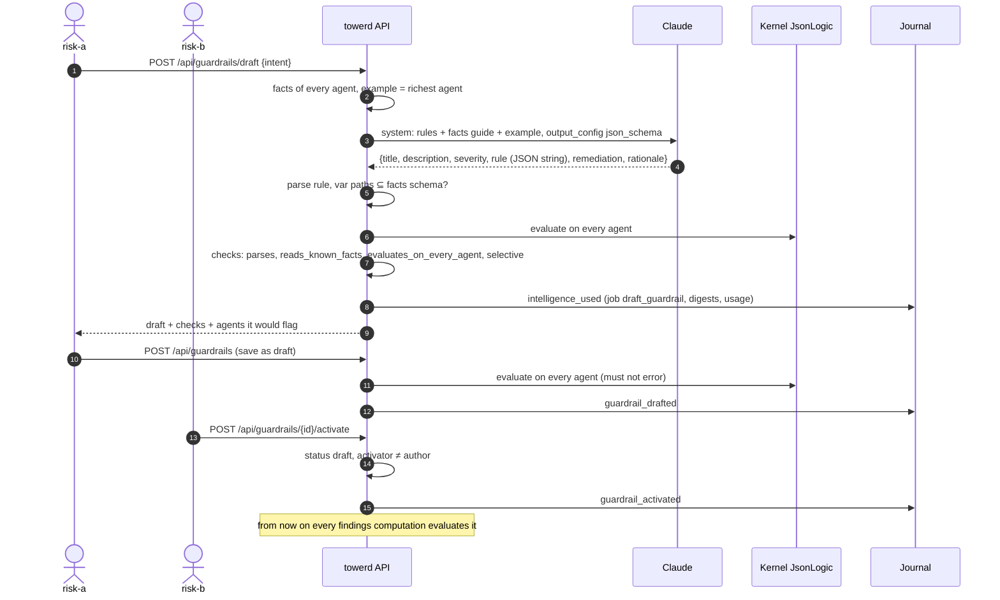
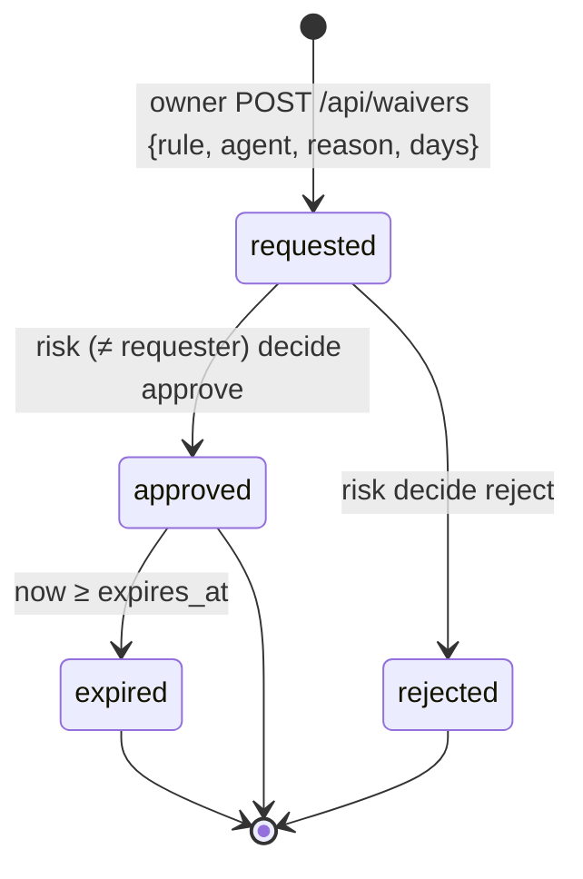
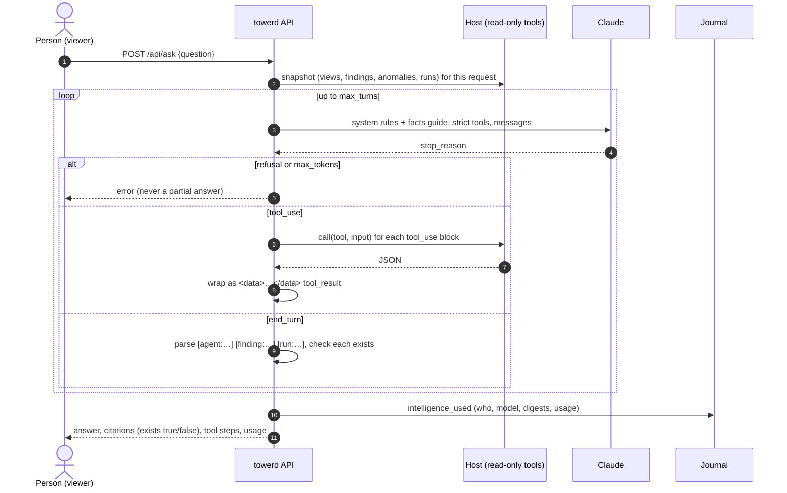
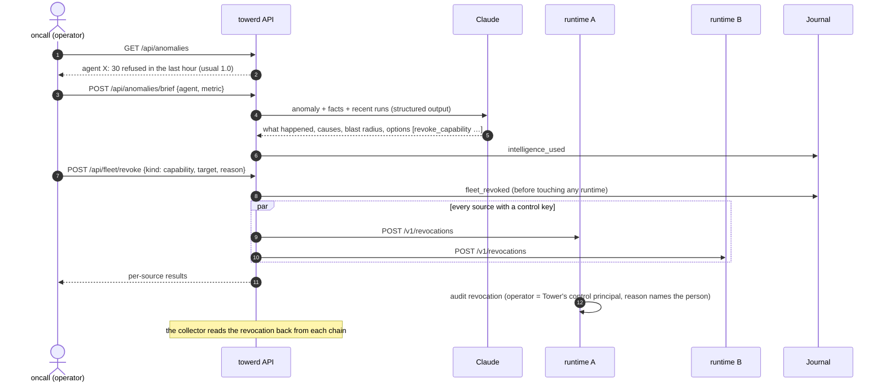
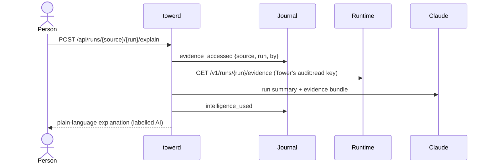
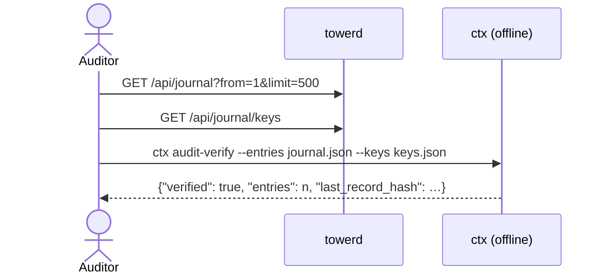

# 3. Flows

Each flow shows the sequence, then lists the steps with the function that performs each,
so you can follow it in the code.

## 3.1 From an agent's run to a finding

The path every fact in Tower takes: an orchestrator admits a run, the runtime signs it,
the collector verifies it, the fleet model folds it, and the governance engine turns it
into findings when someone asks.



| Step | Code |
|---|---|
| Admission is audited before the run starts | `contextosd::app::admit` (`"run_admitted"`) |
| Pull a page from the verified anchor | `towerd::collector::sync` → `Source::entries` |
| Verify the page against the runtime's keys | `contextos_audit::verify_chain` |
| Fold each entry | `towerd::fleet::Fleet::apply` (table in [Governance model](04-governance-model.md#41-from-audit-entries-to-the-fleet-model)) |
| Compute a view on request | `towerd::api::snapshot` → `governance::views` → `governance::findings` |

Nothing is computed ahead of time except the fleet counters. Findings are a pure function
of (fleet model, records) at the moment of the request, so they always reflect the
latest declarations, reviews, guardrails and waivers.

## 3.2 The collector, including failure



- On first contact the anchor is empty, so verification starts at genesis: the first
  entry must have sequence 1 and no previous hash.
- A network or HTTP error sets `last_error` and the collector tries again on the next
  poll. Only a verification failure stops a source, because only that means the
  history cannot be trusted.
- A broken source produces a `chain_broken` critical finding and a red banner on
  Posture. Tower shows nothing after the failing entry as fact.

## 3.3 Declare, review, drift



The review stores the exact list of capabilities it approved and the digest of the
graph. Drift is computed against that list on every request, so a new pack version that
adds a capability shows up the moment the collector refreshes the packs (within 60 s).

## 3.4 A guardrail from intent to enforcement



A guardrail that reads a field the facts do not have, errors on any agent, or (with
`==`) compares arrays by reference is rejected before it can be saved. An active
guardrail that fails at evaluation time produces a high finding ("could not be
evaluated"): it fails visibly, never as a silent pass.

## 3.5 A waiver



While approved and unexpired, the matching finding (same rule, same agent) is returned
with its `waiver` attached and excluded from counts; it is never deleted. Expiry is
computed at read time, so no job is needed.

## 3.6 Ask Tower



The UI links verified citations and marks unverified ones in red with a warning not to
rely on them. Details in [Intelligence](05-intelligence.md).

## 3.7 Anomaly, brief, contain



The AI suggests options; the operator chooses and types the target to confirm. The
journal entry is written before any runtime is called, so an interrupted kill switch is
still on record. Each runtime records the change in its own chain too.

## 3.8 Explain a run



## 3.9 Verify Tower's journal offline



```sh
curl -s -H "authorization: Bearer $KEY" "$TOWER/api/journal?from=1&limit=500" | jq .entries > journal.json
curl -s "$TOWER/api/journal/keys" > keys.json
ctx audit-verify --entries journal.json --keys keys.json
```

Changing any recorded payload (for example a review's decision) makes verification fail
with `payload digest mismatch` at that entry.
