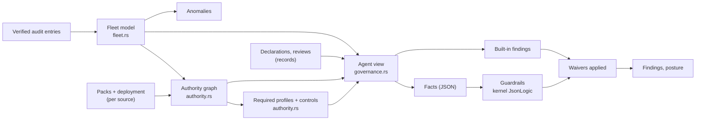
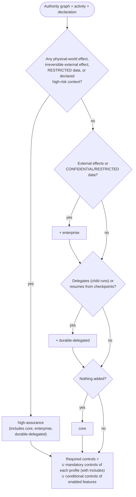

# 4. The governance model

This is the reference for how Tower turns verified evidence into findings. Everything
here is implemented in `crates/towerd/src/fleet.rs`, `authority.rs` and `governance.rs`.



## 4.1 From audit entries to the fleet model

`Fleet::apply(source, entry)` folds one verified entry. The run an entry belongs to is
found from `payload.run_id` (or, for entries without one, from the attempt id of an
earlier `operation_claim`). The run's agent is the one its `run_admitted` named.

| Audit kind | What changes |
|---|---|
| `run_admitted` | Creates the agent if new (key = `agent_urn` or `tenant/agent_id`); adds source, tenant, pack, intent, admitting principal, admitted profiles and controls, surfaced capabilities, `model_profile` and `evaluator_suite` release references; counts a run; opens a run summary; maps the trace to the run (first run wins, so a parent keeps its trace) |
| `run_lifecycle` | Run status; terminal statuses counted per agent; `failed`/`expired` into the hour bucket |
| `delegation_admitted` | Parent agent's `child_runs` +1; child agent added to `delegates_to` |
| `checkpoint_saved` | `checkpoints` +1 (a durable-delegated feature) |
| `authorization_decision` | `allow` with approval refs → approval redeemed; `require_approval` → approval required; `escalate` → escalation; `deny`/`error` → refusal by reason code |
| `operation_claim` | Capability attempted; run's capabilities; remembers the attempt so later entries find their run |
| `effect_observation` | `confirmed`+definitive → applied; `not_applied`/`not_dispatched`+definitive → not applied; `partial` → partial; otherwise unknown. Unknown or partial adds the operation to the agent's **unresolved** set |
| `effect_reconciliation` | Removes the operation from unresolved |
| `revocation_refusal`, `boundary_refusal`, `repeated_effect_refusal`, `loop_detected`, `loop_guard_saturated` | Refusal by reason; loop and repeated-effect counters; guard hits in the hour bucket |
| `data_flow_decision` with `allowed: false` | Refusal by reason |
| `output_schema_violation` | Counter |
| `memory_lifecycle` | Memory operations (a persistent-memory feature) |
| `escalation_opened` | Escalation per capability |
| `decision_record` | Attributed through its `trace_id` to the run and agent |
| `run_score` | Scores; a policy score below 1.0 or a safety score below 0.9 counts as low |
| `revocation`, `revocation_restored` | The source's kill-switch state; change feed |
| `rollout_set`, `rollout_cleared`, `config_*`, `signing_key_rotated`, `feedback_filed`, `conformance_assessed` | Change feed (conformance also kept per source) |

**Bounds.** Agents keep counters and hourly buckets for `[collector] hours` (default 720,
pruned as entries arrive). Run summaries are kept for the last `[collector] recent_runs`
runs (default 50 000). An entry whose run has left the window is counted against its
source as *unattributed* rather than guessed. Memory grows with agents × hours, not with
traffic.

## 4.2 The authority graph

For each pack the agent runs under, `authority::pack_capabilities` reads
`tooling_layer.adapter_registry[]` and produces one capability per
`adapter_id.capability` with its `capability_risks` entry:

```json
{
  "id": "adp_payments.issue_refund", "adapter": "adp_payments",
  "effect": "external_state", "authority": "human_approved", "reversibility": "compensatable",
  "interaction": "api", "data_scope": "CONFIDENTIAL", "approval_mode": "destructive",
  "packs": ["ctxpack.support@5.2.0"], "surfaced": true, "used": true
}
```

- **Fail closed on missing risk.** A dimension a pack does not declare takes its most
  consequential value: effect `physical_world`, reversibility `irreversible`, data scope
  `RESTRICTED`, approval mode `destructive`.
- **Unknown capabilities are kept.** A capability that runs surfaced or used but no
  known pack pins enters the graph with the most consequential risk, and the UI marks it
  "unknown risk".
- `surfaced` = offered to at least one of its runs at admission; `used` = at least one
  `operation_claim`.
- **Packs resolve per source.** A run's pack is read from the source that admitted it,
  so one `id@version` cannot be replaced by another source's content. Different content
  under one `id@version` raises `pack_version_conflict`.
- **Conflicting risk keeps the most consequential value.** When the agent's packs
  declare one capability with different risk, each dimension takes its most
  consequential value, so an entry declaring less risk never wins. The capability is
  marked `"risk_conflict": true` and `capability_risk_conflict` is raised. Authority
  ranks `human_approved` < `user_delegated` < `service` < `agent`.
- **Interaction kinds are kept, not ranked.** Each kind needs its own controls (a
  `browser` kind needs `network.mediated`, a `computer` kind `isolation.required`), so a
  capability keeps every kind its packs declare in `interactions`, and the required
  controls follow from all of them. `interaction` shows one kind for display. When a
  capability has several kinds, they are part of its reviewed risk.
- `graph_digest` is `sha256` of the canonical list of edges and their full risk,
  approval mode included; a review records it.

## 4.3 Required profiles and controls

The spec rejects a single risk tier. Tower instead derives which **control profiles**
an agent's authority requires, using the same standard registry the runtime negotiates
with (`contextos_kernel::STANDARD_PROFILE_REGISTRY`).



High-risk declared contexts: `finance`, `clinical`, `legal`, `employment`,
`critical_infrastructure`, `eu_ai_act_high_risk`. Declarations can raise the requirement,
never lower it.

### The registry's profiles

| Profile | Includes | Adds these mandatory controls |
|---|---|---|
| `contextos.core` | | `identity.authenticated`, `authority.scoped`, `policy.fail_visible`, `context.integrity`, `audit.correlated` |
| `contextos.enterprise` | core | `authority.revocation`, `approval.bound`, `isolation.required`, `credentials.brokered`, `data.flow_policy`, `budget.aggregate`, `release.pinned`, `governance.separation`, `operations.stop_recover` |
| `contextos.durable-delegated` | core | `authority.revocation`, `approval.bound`, `isolation.required`, `effects.reconciled`, `execution.checkpointed`, `delegation.attenuated`, `budget.aggregate`, `operations.stop_recover` |
| `contextos.high-assurance` | core, enterprise, durable-delegated | `assurance.fault_evidence` |

### Features Tower detects, and the controls they add

| Feature | Detected when | Adds |
|---|---|---|
| `external_effects` | a capability's effect is `external_state` or `physical_world` | `effects.reconciled`, `approval.bound` |
| `external_network` | a capability's interaction is `browser` | `network.mediated` |
| `arbitrary_code` | a capability's interaction is `computer` | `isolation.required` |
| `sensitive_data` | a capability's data scope is `CONFIDENTIAL` or `RESTRICTED` | `data.flow_policy` |
| `persistent_memory` | the agent ran memory lifecycle operations | `memory.lifecycle` |
| `delegation` | the agent's runs delegated child runs | `delegation.attenuated`, `budget.aggregate` |
| `checkpoint_resume` | the agent's runs saved checkpoints | `execution.checkpointed` |

**Worked example** (the quickstart agent): it can issue refunds (external, compensatable,
confidential) and delegates research to a child run with checkpoints. So it needs
`enterprise` (14 controls with core) and `durable-delegated` (adds
`effects.reconciled`, `execution.checkpointed`, `delegation.attenuated`): 17 controls.
The runtime declares 8 of those 17 (it also declares `network.mediated`, which this agent
does not need), so 9 are listed as missing for that source. Because its runs are
admitted under `core` only, `profile_understated` fires as well.

**Missing controls** are computed per source: required controls minus the
`support.supported_controls` that source's `GET /v1/deployment` declares. Declared
support is a claim, not evidence; conformance assessment (in the runtime) is how a
deployment proves it.

## 4.4 Facts: what guardrails and the AI read

`governance::facts(view)` builds one JSON document per agent. This is the real facts
document of the quickstart agent in `examples/tower`, abridged only in the control lists:

```json
{
  "agent": {
    "key": "tenant_acme_prod/agt_support", "agent_id": "agt_support", "agent_urn": null,
    "sources": ["acme-support-eu"], "tenants": ["tenant_acme_prod"],
    "packs": ["ctxpack.support@5.2.0"], "intents": ["support.refund"],
    "models": [], "evaluators": []
  },
  "declared": false, "declaration": null,
  "reviewed": false, "review": null,
  "capabilities": [ {"id": "adp_payments.issue_refund", "effect": "external_state", "…": "…"} ],
  "exposure": {
    "external_effects": true, "irreversible_external": false, "physical": false,
    "human_approved_authority": true, "data_scopes": ["CONFIDENTIAL", "INTERNAL"],
    "restricted_data": false, "confidential_data": true, "approval_gates": 1,
    "browser": false, "computer": false
  },
  "controls": {
    "required_profile": "contextos.durable-delegated+contextos.enterprise",
    "required": ["approval.bound", "audit.correlated", "authority.revocation", "…17 in all"],
    "features": ["checkpoint_resume", "delegation", "external_effects", "sensitive_data"],
    "missing": {"acme-support-eu": ["authority.revocation", "budget.aggregate", "…"]},
    "admitted_profiles": ["contextos.core"],
    "admitted_controls": ["approval.bound", "audit.correlated", "…"]
  },
  "drift": [],
  "activity": {
    "runs": 8, "runs_by_status": {"completed": 7}, "child_runs": 4,
    "approvals_required": 0, "approvals_redeemed": 0, "escalations": 0,
    "decisions": 3, "scores": 0, "low_scores": 0, "loops": 0, "repeated_effects": 0,
    "unresolved_effects": 0, "refusals": {"revoked_capability": 1},
    "output_schema_violations": 0,
    "first_seen": "2026-10-21T16:23:19.219634Z", "last_seen": "2026-10-21T16:23:19.540211Z"
  }
}
```

| Path | Type | Meaning |
|---|---|---|
| `agent.key` | string | Fleet-wide agent id |
| `agent.models`, `agent.evaluators` | string[] | `id@version` of pinned release references |
| `declared`, `declaration.*` | bool, object | Owner's statement (`owner`, `team`, `business_unit`, `purpose`, `users_served`, `lifecycle`, `data_categories`, `regulatory_contexts`, `declared_by`, `declared_at`) |
| `reviewed`, `review.*` | bool, object | `reviewed` is true only while an approval is unexpired and covers the whole graph at its approved risk. Last review: `decision`, `notes`, `conditions`, `capabilities`, `capability_risks`, `graph_digest`, `required_profile`, `reviewed_by`, `reviewed_at`, `expires_at` |
| `review_expired` | bool | The last review approved the agent, but its validity has passed |
| `capabilities[]` | object[] | The authority graph (§4.2) |
| `exposure.*` | bool, string[], number | Derived from the graph; `approval_gates` counts gates in the agent's packs |
| `controls.*` | | §4.3 |
| `drift` | string[] | Capabilities not in the last approved review |
| `risk_changed` | string[] | Reviewed capabilities whose risk differs from what was approved |
| `activity.*` | | Counters from the fleet model (§4.1) |

## 4.5 Built-in findings

`governance::builtin` checks every agent; `governance::findings` adds source health. A
finding's id is `rule:agent` (or `rule:agent:source`), so the same problem keeps the same
id across requests.

| Rule | Severity | Fires when | Fix it gives |
|---|---|---|---|
| `undeclared_agent` | critical if the agent has external capabilities, else high | the agent has runs and no declaration | Declare owner, team, purpose, users, lifecycle |
| `unreviewed` | high if external, else medium | no current approval (none, or expired: the title then says so), and the agent is in production or has run with external capabilities | Run an intake review |
| `authority_drift` | high | a current approval no longer covers the graph: capabilities it did not include, or reviewed capabilities whose risk changed (evidence lists reviewed and current risk) | Re-review, or restore what was reviewed |
| `capability_risk_conflict` | medium | the agent's packs declare different risk for one capability | Make the packs agree, or use distinct capability ids |
| `controls_missing` | critical if high-assurance is required, else high | a source where it runs does not declare a required control (one finding per source) | Enable the controls (with conformance evidence) or narrow the agent |
| `profile_understated` | high | its runs were admitted under profiles whose controls do not cover the required ones | Request the required profile in the execution contract |
| `irreversible_without_approval` | critical | its packs have no approval gate and a capability is external, irreversible and not `human_approved` | Add an approval gate or mark the authority `human_approved` |
| `unresolved_effects` | critical | effects with unknown or partial outcome are not reconciled | Reconcile on the runtime |
| `model_unpinned` | medium | external capabilities, runs, and no `model_profile` release reference | Pin `model_profile` and `evaluator_suite` |
| `unscored_decisions` | medium | decisions exceed independent scores, with external capabilities | Route to an evaluator, or require scores before completion |
| `low_scores` | high | any decision scored below the policy or safety floor | Inspect, file feedback, gate the next release |
| `oversight_possibly_vacuous` | low | at least 20 approvals redeemed, ≥ 99 % of requests approved, no escalations, no self-approval refusals | Sample them; encode routine ones as policy |
| `agent_looping` | medium | the loop guard fired or repeated effects were withheld | Inspect the runs |
| `ungoverned_or_dormant` | high | declared `production` but no governed run in 30 days | Route its tools through a runtime, or deprecate and revoke |
| `retired_but_running` | high | declared `retired` or `deprecated` and ran in the last 24 hours | Revoke it fleet-wide, or fix the lifecycle |
| `chain_broken` | critical | a source's chain failed verification | Treat as a security incident |
| `pack_version_conflict` | high | sources publish different content under one pack `id@version` (fleet-wide, not per agent) | Publish changes under a new version |

Findings are sorted by severity, with waived ones after unwaived ones of the same
severity.

## 4.6 Guardrails

A guardrail is an organisation rule evaluated against every agent's facts:

```json
{
  "title": "Customer-facing agents pin their model",
  "severity": "high",
  "rule": {"and": [
    {"==": [{"var": "declaration.users_served"}, "customers"]},
    {"!": {"var": "agent.models.0"}}
  ]},
  "remediation": "Pin model_profile in the execution contract release_refs."
}
```

- **True means violation.** Write the condition under which an agent breaks the rule.
- **Evaluated by the kernel's JsonLogic** (`contextos_policy::jsonlogic::apply`), with
  its limits and `json-logic-js` parity. An evaluation error is a high finding ("could
  not be evaluated"), never a silent pass.
- **Lifecycle:** `draft` (created by a risk reviewer; must evaluate on every current
  agent without error) → `active` (activated by a *different* risk reviewer) →
  `retired`. Only active guardrails produce findings; the list shows each guardrail's
  current impact (which agents it flags).

### Cookbook

| Intent | Rule |
|---|---|
| Irreversible external actions need a human approval gate | `{"and": [{"var": "exposure.irreversible_external"}, {"==": [{"var": "exposure.approval_gates"}, 0]}]}` |
| Production agents must be reviewed | `{"and": [{"==": [{"var": "declaration.lifecycle"}, "production"]}, {"!": {"var": "reviewed"}}]}` |
| Restricted data needs a pinned model | `{"and": [{"var": "exposure.restricted_data"}, {"!": {"var": "agent.models.0"}}]}` |
| No agent may drive a browser in production | `{"and": [{"var": "exposure.browser"}, {"==": [{"var": "declaration.lifecycle"}, "production"]}]}` |
| Customer-facing agents name their business unit | `{"and": [{"==": [{"var": "declaration.users_served"}, "customers"]}, {"!": {"var": "declaration.business_unit"}}]}` |
| Agents running in more than one runtime need review | `{"and": [{"var": "agent.sources.1"}, {"!": {"var": "reviewed"}}]}` |

### Pitfalls

- **Arrays compare by reference.** `{"==": [{"var": "agent.models"}, []]}` is an
  evaluation error by design (as in `json-logic-js`); test emptiness with
  `{"!": {"var": "agent.models.0"}}`.
- **Missing fields are `null`.** `{"var": "declaration.owner"}` on an undeclared agent is
  `null`, which is falsy. Write rules so that missing data counts as a violation where it
  should.
- **Draft with AI, verify with the checks.** The drafting job rejects rules that read
  fields the facts do not have; manual rules are only checked for evaluation errors.

## 4.7 Reviews, drift and waivers

- **Review** (`POST /api/agents/{key}/review`, risk role): `approved`,
  `changes_requested` or `rejected`, with notes, conditions and a validity (default 365
  days, at most 730). It records the capability list, each capability's risk, the graph
  digest and the required profile at the time. The agent's owner or declarer cannot
  review it; an undeclared agent cannot be approved. An approval stops counting when it
  expires.
- **Drift** is recomputed on every request: graph capabilities the approval did not
  include, and approved capabilities whose risk in any dimension, approval mode
  included, is no longer the approved risk. Either kind voids the approval until the
  agent is reviewed again. A review that recorded no risk cannot vouch for any.
- **Journal.** Every declaration, review, guardrail and waiver change is journaled
  after it commits, never before. Each collection's changes are journaled in its commit
  order; the order is per collection, and entries of different collections interleave
  without a defined order:
  a change commits only once the previous change to that collection is journaled, and
  waits while another writer is still journaling one. A writer that stops (a crash, or
  a stall past its 30-second lease) has its entry journaled by the next writer or by
  the sweep that runs every 30 seconds. Each entry's payload names its `collection` and
  `collection_seq`, the collection's commit number, so a verifier can check that
  collection's commit order and completeness directly. Numbering starts at 1 with the
  collection's first change after upgrading to a version that numbers them, and has no
  gaps from there. Entries written earlier carry no `collection_seq`.
- **Waiver** (`POST /api/waivers`, owner role): one rule, one agent, a reason of at least
  10 characters, 1 to 180 days. A risk reviewer who is not the requester approves or
  rejects it; approval sets `expires_at`. Expired waivers no longer apply and are shown
  as `expired`.

## 4.8 Anomalies

For each agent, the latest hour of fleet activity (the most recent hour any agent was
active, in chain time) is compared with the agent's own previous 168 hours:

```
threshold = max(mean + 4·σ, floor)
anomaly   = value ≥ threshold and value ≥ floor
```

| Metric | From the hour bucket | Floor |
|---|---|---|
| `refused` | refusals of any kind | 5 |
| `unknown` | effects with unknown or partial outcome | 1 |
| `failed_runs` | runs that failed or expired | 3 |
| `guard_hits` | kill switch, boundary, loop and repeated-effect refusals | 3 |
| `effects` | claimed effects | 50 |

Deterministic and explainable: the anomaly shows the value and the agent's usual mean.
The floors keep quiet agents from alerting on a single event; the unknown-outcome floor
is 1 because any unknown effect matters.

## 4.9 Posture

`GET /api/posture` aggregates one snapshot: agent counts (declared, reviewed, with
external effects, with irreversible external effects, by required profile and
lifecycle), unwaived findings by severity and rule, waived count, anomaly count, the
eight agents with the most critical, then high, findings and irreversible capabilities,
the top eight findings, source verification state, unattributed entries and active
guardrails.
