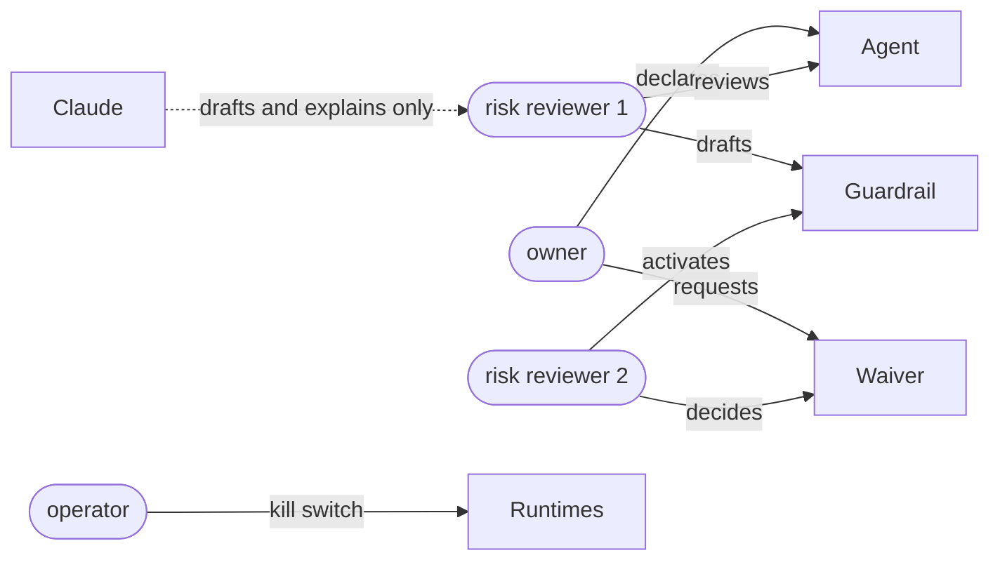

# 7. Security

Tower is a high-value target: it sees the whole fleet and can stop agents. This
document states what it trusts, what it defends against, and what it does when
something fails. The runtime's own threat model is in
[docs/security/THREAT_MODEL.md](../security/THREAT_MODEL.md) (Tower is T26 and T27 there).

## 7.1 What Tower trusts

| Tower trusts | Because | It does not trust |
|---|---|---|
| A runtime's **published signing keys** | They are what the runtime signs with; `ctx audit-verify` uses the same keys | Any audit entry that does not verify under them |
| Its own configuration file | It is deployed like code | Anything a person or a model says about an agent's capabilities |
| The kernel's profile registry and JsonLogic evaluator | They are the runtime's own, parity-tested | Model output, until a deterministic check and a person accept it |
| The people its keys name, within their roles | Roles are configured by administrators | Requests that would let someone approve their own work |

## 7.2 Threats and controls

| # | Threat | Control | Test |
|---|---|---|---|
| 1 | A forged or altered audit history makes an agent look compliant | Every page verified (payload digest, record hash, link, Ed25519) from genesis or a verified anchor; failure stops the source and raises `chain_broken` | `contextos-audit` tamper tests; collector path in `towerd` e2e |
| 2 | A compromised Tower forges runtime history | Tower never holds a runtime signing key; runtime chains remain the record, verifiable independently | Architecture |
| 3 | Tower used to act with more authority than intended | Reads with `audit:read` keys only; acting needs an explicit `control` key per source; every action is also audited by the runtime under its own scopes | Source configuration |
| 4 | One person approves their own risk | Owners and declarers cannot review their agents; guardrail authors cannot activate them; waiver requesters cannot decide them | `governance_actions_need_the_right_role_and_a_second_person` |
| 5 | A model drives a change | No intelligence route writes a record or calls a runtime; outputs are proposals; changes are separate role-checked calls | API design; `jobs.rs` tests |
| 6 | Prompt injection through governed data | Analyst tools are read-only; tool results wrapped as `<data>`; system prompt forbids following instructions in data | `the_analyst_uses_tools_wraps_their_output_as_data_and_checks_citations` |
| 7 | Hallucinated facts presented as evidence | Citations checked against the snapshot; drafted guardrails checked for unknown fields and evaluation errors | `a_drafted_guardrail_is_checked_against_the_inventory` |
| 8 | A guardrail that silently never fires | Evaluation errors are findings, not passes; reference comparisons fail visibly | `guardrails_are_jsonlogic_over_facts_and_errors_are_visible` |
| 9 | Governance decisions denied later | Every decision signed into the journal before or as it takes effect; verifiable offline | `ctx audit-verify` on the journal |
| 10 | Key theft from the browser | Strict CSP (same-origin scripts, styles, connections; no inline script; no framing); key in tab `sessionStorage`, sent only as `Authorization`, never a cookie (so no CSRF) | `console.rs` tests |
| 11 | Path traversal or unexpected files served | The UI build is read into memory at start; requests never touch the filesystem; unknown file types refuse to load | `console.rs` tests |
| 12 | Published example keys in production | `towerd` refuses them unless `[server] development = true`; the runtime refuses its published keys in production | config tests |
| 13 | Personal data spreads into the governance plane | Tower ingests identifiers and counts only; evidence is fetched on request, journalled, never stored | Architecture |
| 14 | A business unit wants observation without remote control | Give that source no `control_token_env`; the kill switch skips it | Source configuration |

## 7.3 Roles and separation of duties

| Action | Allowed roles | Refused when |
|---|---|---|
| Declare an agent | owner (own teams), risk, admin | an owner declares for a team they are not in, or moves another team's agent |
| Review an agent | risk, admin | the reviewer is the agent's owner or declarer; approving an undeclared agent |
| Draft a guardrail | risk, admin | the rule fails to evaluate on any agent |
| Activate a guardrail | risk, admin | the activator drafted it; it is not a draft |
| Request a waiver | owner, risk, admin | reason under 10 characters; outside 1–180 days |
| Decide a waiver | risk, admin | the decider requested it; already decided |
| Fleet kill switch | operator, admin | no selected source has a control key |
| AI drafts and briefs | as listed in [Intelligence](05-intelligence.md) | intelligence off |

Separation of duties is checked against principal ids in `towerd`, not only hidden in
the UI. `admin` passes every role check but not the separation checks.

## 7.4 Keys and secrets

| Secret | Held where | Scope |
|---|---|---|
| Runtime `audit:read` key, per source | Environment variable named by `token_env` | Read one tenant's chain, deployment, packs, evidence |
| Runtime `control` key, per source (optional) | `control_token_env` | Revoke and restore on that tenant |
| Tower journal seed | `[journal] signing_seed_env` | Sign Tower's journal |
| People's Tower keys | Configured as SHA-256 hashes in `[[api_keys]]` | Their roles |
| Anthropic API key (optional) | `[intelligence] api_key_env` | Model calls |

The configuration file holds no secrets: hashes and environment variable names only.
Keys are compared in constant time over every configured key. A runtime key should
belong to a dedicated principal (for example `svc_tower`) with only `audit:read`, so the
runtime's own audit shows Tower's reads distinctly.

## 7.5 Failure behaviour

| Failure | What Tower does |
|---|---|
| Runtime unreachable | Keeps the last state; `last_error` on the source; retries every poll |
| Audit page fails verification | Marks the source broken, stops reading it, raises a critical finding and a banner |
| Unknown signing key | Reloads the published keys once (rotation); if still unknown, treats as a broken chain |
| Store or journal unavailable | Refuses the change (`503`); nothing is half-applied, because the journal is written first and records change by compare-and-swap |
| Kill switch fails on some runtimes | Returns per-source results; the journal records the attempt before any call |
| Model service down, refuses or truncates | The AI route returns an error; nothing else is affected |
| `towerd` down | Runtimes and agents are unaffected; governance views are unavailable until it returns and re-verifies |
